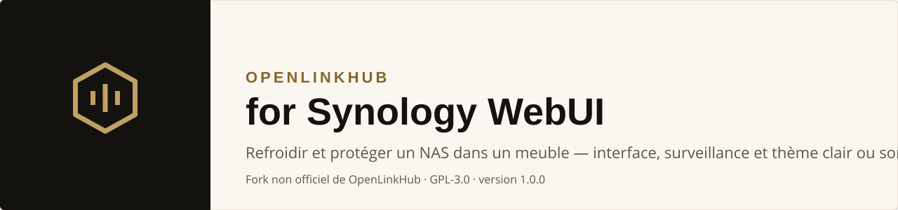
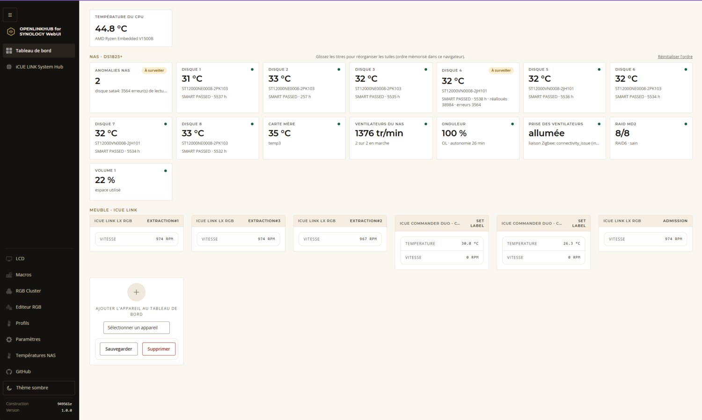
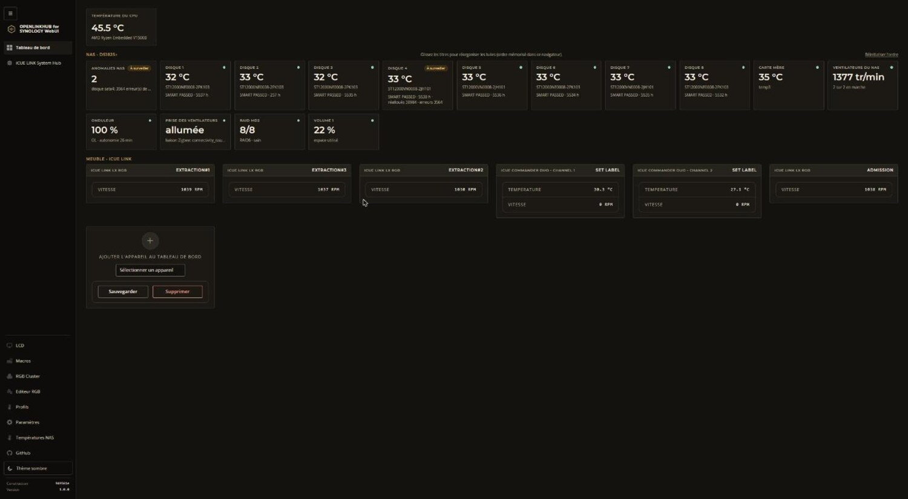
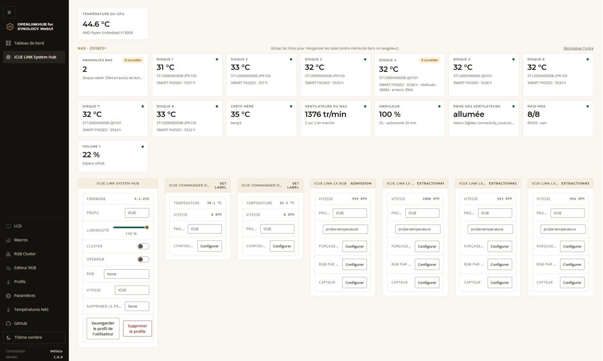
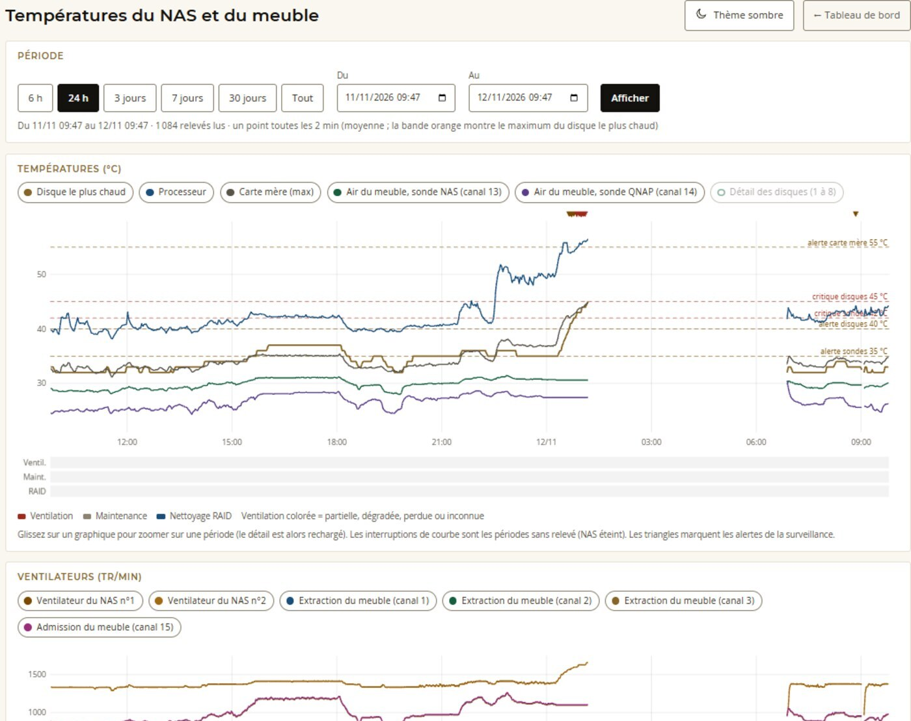
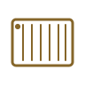
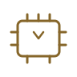
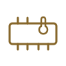
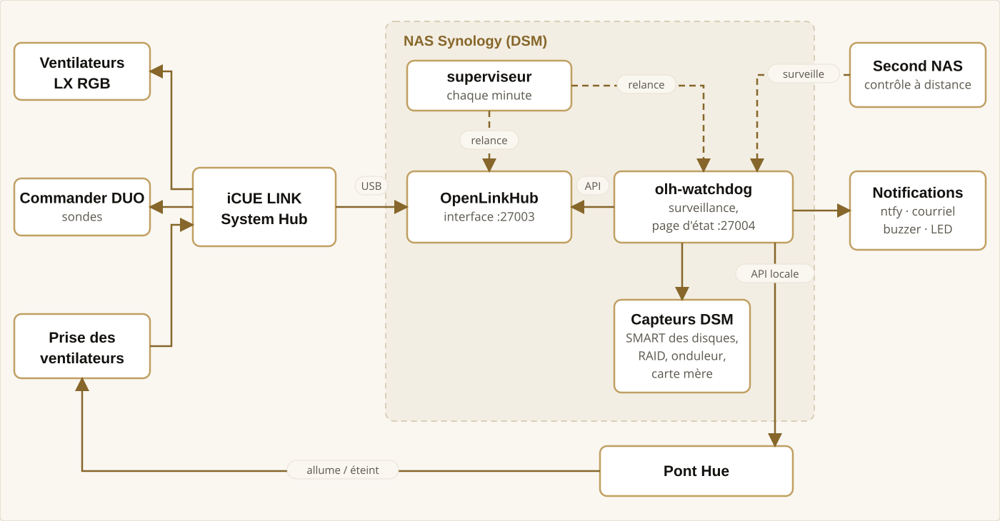

<p align="center">
  <picture>
    <source media="(prefers-color-scheme: dark)" srcset="img/banner-fr-dark.svg">
    
  </picture>
</p>

<p align="center"><a href="README.md">English</a> · <b>Français</b></p>

> [!IMPORTANT]
> **Projet source / Upstream project — [OpenLinkHub](https://github.com/jurkovic-nikola/OpenLinkHub) par [jurkovic-nikola](https://github.com/jurkovic-nikola), licence GPL-3.0.**
>
> **Ce dépôt est un fork non officiel, adapté au NAS Synology (DSM). Le pilotage des appareils Corsair iCUE LINK, l'interface web d'origine et tout le travail de fond sont l'œuvre du projet source : allez voir son dépôt, soutenez-le, et signalez-lui les défauts de ses propres fonctions. Ce fork n'est ni approuvé ni soutenu par son auteur.**
>
> *EN — This is an unofficial fork of [OpenLinkHub](https://github.com/jurkovic-nikola/OpenLinkHub), adapted to run on a Synology NAS (DSM). The device support, the original web UI and the core work belong to the upstream project (GPL-3.0). This fork is not endorsed by its author; please report upstream issues upstream.*

## Info

- Né d'un vrai besoin : refroidir un NAS Synology enfermé dans un meuble, et le protéger quand la ventilation tombe.
- **Aucune garantie, aucune responsabilité.** Utilisation à vos risques. Les scripts s'exécutent en root et peuvent éteindre votre NAS : lisez-les d'abord et commencez par le mode à blanc (`-dry`).
- Développé et testé sur le matériel de l'auteur (voir [Matériel](#matériel-utilisé)) ; rien d'autre n'a été testé.
- Ce n'est **pas** un produit officiel de Corsair, de Synology ni d'OpenLinkHub.

<p align="center">
  <a href="#ce-que-ce-fork-ajoute">Nouveautés</a> ·
  <a href="#captures">Captures</a> ·
  <a href="#matériel-utilisé">Matériel</a> ·
  <a href="#architecture">Architecture</a> ·
  <a href="docs/INSTALLATION.fr.md">Installation</a> ·
  <a href="#sécurité-et-limites">Sécurité</a> ·
  <a href="#licence-et-crédits">Licence</a> ·
  <a href="CHANGELOG.fr.md">Historique</a>
</p>

## En bref

Un NAS à 8 baies enfermé dans un meuble chauffe vite. Ce projet le **refroidit avec des ventilateurs iCUE LINK** pilotés depuis le NAS lui-même (OpenLinkHub, compilé pour DSM), et le **protège** : une surveillance en Go (`olh-watchdog`) lit les températures des disques, du processeur et du meuble, l'état du RAID, de l'onduleur et des ventilateurs, **alerte** sur le téléphone et par courriel, fait clignoter les ventilateurs, et **éteint proprement le NAS** quand la ventilation est perdue ou qu'un disque tient une température dangereuse.

Il est né d'un incident réel : une nuit, l'alimentation des ventilateurs a été coupée alors que le NAS tournait encore. Les disques ont atteint 45 °C en une heure, et seul le dernier garde-fou a éteint la machine. Tout ce qui suit est construit pour que cela ne se reproduise pas.

## Ce que ce fork ajoute

| | |
|---|---|
| **Fonctionne sur DSM** | OpenLinkHub compilé pour Synology (sans PipeWire ni udev), lancé au démarrage, reset USB du Hub, relance automatique s'il plante |
| **Thème clair et sombre** | Charte « or et crème » sur toutes les pages, menu latéral sombre, bascule soleil/lune mémorisée par navigateur, Montserrat et Open Sans livrées localement (aucune dépendance à Internet) |
| **Tuiles du NAS** | Disques, carte mère, ventilateurs, onduleur, RAID, volume et prise des ventilateurs sur le tableau de bord, avec un point (normal) ou une pastille avec un mot (à surveiller, critique) — jamais la couleur seule |
| **Onglet « Températures NAS »** | Graphiques sur la période de votre choix (6 h à tout l'historique, dates libres, zoom), seuils, alertes et bandes d'état, relevés à la minute |
| **Surveillance `olh-watchdog`** | Ventilation en 4 états, seuils disques 40/43/45 °C, alerte sonore (buzzer) et lumineuse (LED des ventilateurs), page d'état, mode maintenance, notifications ntfy et courriel |
| **Prise connectée des ventilateurs** | Si la prise s'éteint alors que le NAS tourne, elle est rallumée tout de suite ; si le Hub se fige, cycle de coupure et relance d'OpenLinkHub ; si rien n'y fait, arrêt du NAS (Philips Hue, API locale) |
| **Supervision de la supervision** | Un superviseur relance la surveillance et OpenLinkHub s'ils tombent ; un second NAS peut contrôler que le premier répond |
| **Testé** | 262 tests unitaires sur la surveillance, bancs d'essai des scripts, essais réels des arrêts |

## Captures

<table>
  <tr>
    <td width="50%"><br><sub><b>Tableau de bord — thème clair</b> (par défaut)</sub></td>
    <td width="50%"><br><sub><b>Tableau de bord — thème sombre</b></sub></td>
  </tr>
  <tr>
    <td width="50%"><br><sub><b>Un appareil iCUE LINK</b> — réglages du Hub, ventilateurs, sondes</sub></td>
    <td width="50%"><br><sub><b>Onglet « Températures NAS »</b> — une nuit réelle : la prise est coupée à 0 h 15, les disques montent à 45 °C</sub></td>
  </tr>
</table>

## Matériel utilisé

Ce projet a été développé et éprouvé sur l'installation ci-dessous. D'autres modèles peuvent fonctionner ; seuls ceux-ci sont testés.

<table>
  <tr>
    <td align="center" width="14%"><br><b>NAS</b><br>Synology DS1825+<br><sub>8 baies, DSM 7, RAID 6</sub></td>
    <td align="center" width="14%"><br><b>Hub</b><br>Corsair iCUE LINK System Hub<br><sub>USB vers le NAS</sub></td>
    <td align="center" width="14%"><br><b>Sondes</b><br>Corsair iCUE COMMANDER DUO<br><sub>2 sondes de température</sub></td>
    <td align="center" width="14%"><br><b>Ventilation</b><br>4 × iCUE LINK LX RGB 140 mm<br><sub>3 extracteurs, 1 admission</sub></td>
  </tr>
  <tr>
    <td align="center"><br><b>Alimentation</b><br>Philips Hue, prise connectée<br><sub>commandée par le pont Hue</sub></td>
    <td align="center"><br><b>Onduleur</b><br>Eaton 5P<br><sub>lu par le NAS (USB)</sub></td>
    <td align="center"><br><b>Baie USB</b><br>QNAP TR-004<br><sub>surveillée (présence, erreurs)</sub></td>
    <td align="center"><br><b>Disques</b><br>8 × Seagate IronWolf 12 To<br><sub>SMART lu par la surveillance</sub></td>
  </tr>
</table>

<sub>Les pictogrammes sont des dessins originaux. Corsair, iCUE, iCUE LINK, Synology, DSM, Philips Hue, Eaton, QNAP et Seagate sont des marques de leurs propriétaires respectifs, citées uniquement pour désigner le matériel compatible ; ce projet n'est affilié à aucun d'eux.</sub>

## Architecture

<p align="center">
  <a href="img/architecture-fr-light.svg?raw=true">
    <picture>
      <source media="(prefers-color-scheme: dark)" srcset="img/architecture-fr-dark.svg">
      
    </picture>
  </a>
  <br><sub>Cliquez sur le schéma pour l'ouvrir en grand.</sub>
</p>

## Protections par défaut

| Situation | Réaction |
|---|---|
| Disque ≥ 40 °C / 43 °C | Alerte / alerte critique ; arrêt si 45 °C pendant 1 minute (47 °C sur deux relevés) |
| Ventilation perdue (aucun extracteur en rotation) | Alerte tout de suite, arrêt du NAS après 15 minutes |
| Prise des ventilateurs éteinte, NAS en marche | Rallumée aussitôt (3 ordres par heure au plus) ; arrêt si elle reste éteinte 5 minutes |
| Hub gelé (toutes les vitesses identiques 10 minutes) | Alerte ; cycle de la prise puis relance d'OpenLinkHub ; arrêt si toujours figé 5 minutes après |
| OpenLinkHub ne répond plus (3 minutes) | Relance automatique, alerte |
| Surveillance arrêtée ou figée | Relance par le superviseur, alerte ; contrôle possible depuis un second NAS |
| Baie USB absente ou en erreur, sonde figée, RAID dégradé, nettoyage des données en cours | Alertes dédiées |

Tous les seuils se règlent par options de la ligne de commande. Un **mode à blanc** (`-dry`) journalise sans rien éteindre : commencez par lui.

## Installation

Le détail pas à pas est dans **[docs/INSTALLATION.fr.md](docs/INSTALLATION.fr.md)** ; l'architecture dans **[docs/ARCHITECTURE.fr.md](docs/ARCHITECTURE.fr.md)**. En résumé :

1. Compiler OpenLinkHub avec nos correctifs (`openlinkhub-patches/`, `outils-build/build3.sh`) et la surveillance (`watchdog/`).
2. Copier les fichiers dans `/volume1/openlinkhub` et créer deux tâches dans le Planificateur de DSM : `start.sh` au démarrage, `superviseur.sh` chaque minute.
3. Renseigner `secrets.env` (copier `secrets.env.exemple`) pour les notifications.
4. Installer le thème (`dist/static/`, `dist/web/`, `dist/installer-theme-goldcream.sh`) puis, en option, la prise Hue.

> [!WARNING]
> Ces scripts tournent en **root** sur votre NAS et peuvent **éteindre le NAS**. Lisez-les avant de les lancer, adaptez les adresses et les chemins à votre installation, et essayez d'abord en mode à blanc.

## Sécurité et limites

- La **page d'état** (port 27004) et l'API de relevés sont **en lecture seule mais sans authentification** : ne les exposez pas hors de votre réseau local. La page de commandes exige un mot de passe (`CONTROL_PASSWORD`).
- Le client Hue **ne vérifie pas le certificat** du pont (auto-signé) ; il ne parle qu'à l'adresse configurée, sur le réseau local. La clé d'accès au pont reste dans `secrets.env`, jamais dans le code.
- L'**analyse des alertes par une IA** (facultative) envoie leur détail (températures, modèles et compteurs de disques, titres d'événements) à l'API d'Anthropic **seulement si vous configurez une clé** ; elle est désactivée par défaut, les alertes ont alors un texte standard.
- Un NAS qui s'éteint tout seul est un risque en soi : prévoyez une sauvegarde, un onduleur, et testez vos protections en réel avant de leur faire confiance.
- Les adresses, comptes et noms qui figurent dans les exemples sont **fictifs** (`192.168.1.10`, `admin`).
- Logiciel fourni **sans aucune garantie**, aux termes de la GPL-3.0.

## Suivre le projet source

```bash
git remote add upstream https://github.com/jurkovic-nikola/OpenLinkHub.git
git fetch upstream
```

Nos modifications d'OpenLinkHub sont volontairement **minces** (`openlinkhub-patches/`, quelques fichiers de page et de style) pour rester faciles à rejouer sur une nouvelle version. Les défauts qui ne concernent pas Synology sont à signaler au projet source.

## Licence et crédits

- **OpenLinkHub** — © son auteur et ses contributeurs, **GPL-3.0** : <https://github.com/jurkovic-nikola/OpenLinkHub>. Ce fork en est un travail dérivé et reste sous **GPL-3.0** (voir [LICENSE](LICENSE)).
- **Surveillance `olh-watchdog`, scripts, thème** — code de ce dépôt, également sous GPL-3.0.
- **Polices** Montserrat et Open Sans — SIL Open Font License 1.1 (textes joints dans `dist/static/fonts/goldcream/`).
- Bibliothèques de l'interface d'origine (Bootstrap, jQuery, DataTables, etc.) : voir le projet source.
- **Développé avec [Claude Code](https://claude.com/claude-code)** (Anthropic, assistant IA), sous la direction de l'auteur ; l'auteur a testé le résultat sur du vrai matériel et reste responsable de ce qui est publié ici.
- Détail des crédits et des marques : [NOTICE.md](NOTICE.md).

<p align="center"><sub>Version 1.0.0 · <a href="CHANGELOG.fr.md">historique des versions</a></sub></p>
