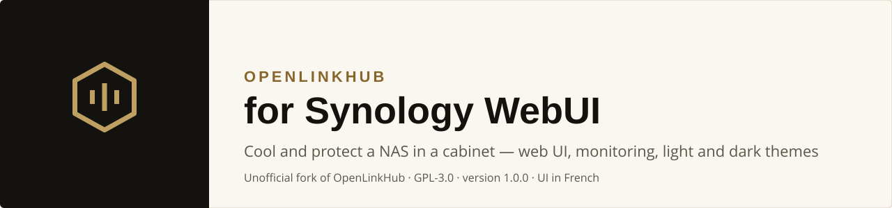
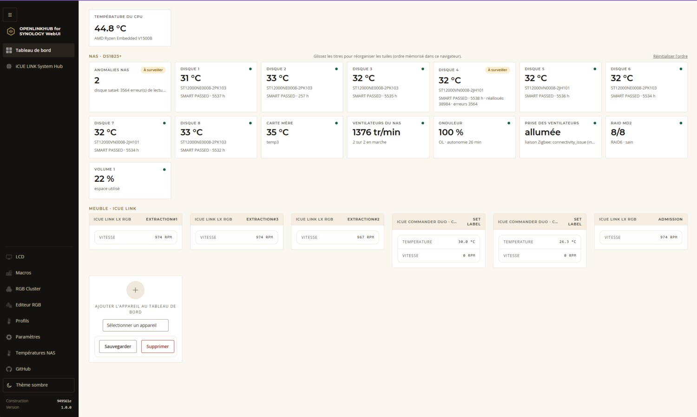
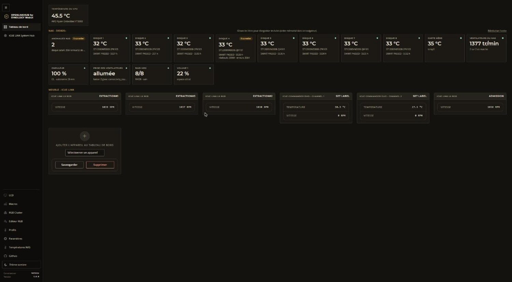
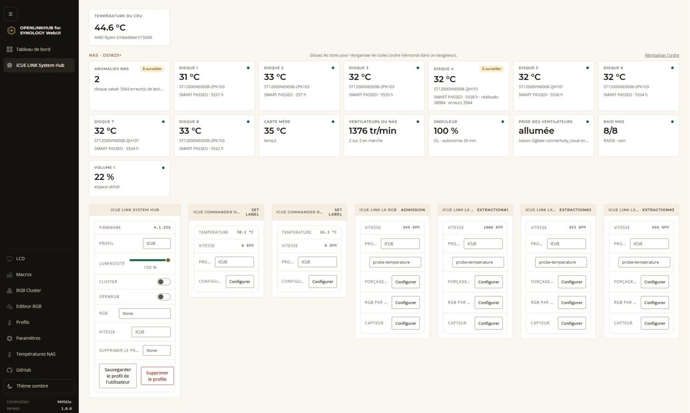
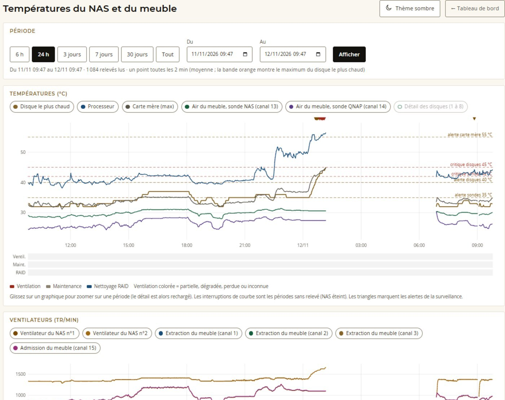
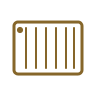
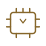
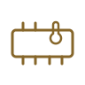
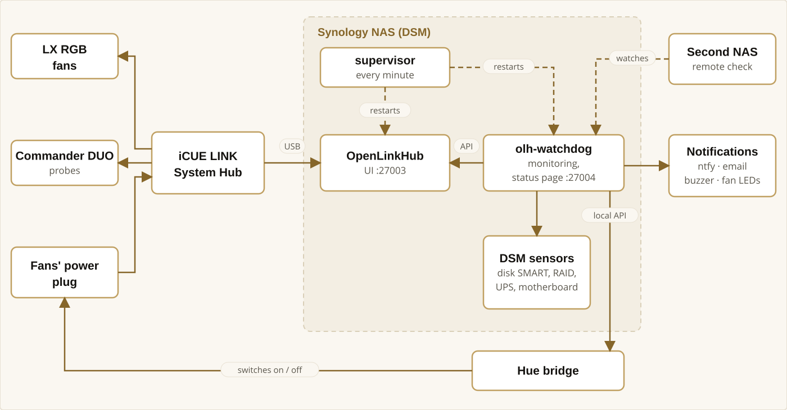

<p align="center">
  <picture>
    <source media="(prefers-color-scheme: dark)" srcset="img/banner-en-dark.svg">
    
  </picture>
</p>

<p align="center"><b>English</b> · <a href="README.fr.md">Français</a></p>

> [!IMPORTANT]
> **Upstream project — [OpenLinkHub](https://github.com/jurkovic-nikola/OpenLinkHub) by [jurkovic-nikola](https://github.com/jurkovic-nikola), GPL-3.0.**
>
> **This repository is an unofficial fork, adapted to run on a Synology NAS (DSM). The Corsair iCUE LINK device support, the original web UI and the core work are the upstream project's: please visit its repository, support it, and report issues in its own features to its author. This fork is not endorsed by the upstream author.**
>
> *FR — Ce dépôt est un fork non officiel de OpenLinkHub, adapté au NAS Synology (DSM). Le pilotage des appareils Corsair, l'interface d'origine et le travail de fond sont l'œuvre du projet source (GPL-3.0). Ce fork n'est pas approuvé par son auteur ; signalez-lui les défauts de ses propres fonctions.* [Lire en français](README.fr.md)

> [!NOTE]
> **Language notice — the application is in French.** The additions made by this fork (dashboard tiles, the “Températures NAS” charts page, menu entries, theme toggle), the watchdog's alerts, notifications and web page, the scripts' messages and the source-code comments are written **in French only**. The upstream OpenLinkHub interface has its own language setting (the screenshots below were taken with it set to French). Pull requests that add English translations are welcome. This README and the guides in `docs/` are available in both languages.

## Info

- Born from a real need: cooling a Synology NAS shut inside a cabinet, and protecting it when the ventilation fails.
- **No warranty and no liability.** Use it at your own risk. The scripts run as root and can shut your NAS down: read them first and start in dry-run mode.
- Developed and tested on the author's own hardware (see [Hardware](#hardware)); nothing else has been tested.
- This is **not** an official Corsair, Synology or OpenLinkHub product.

<p align="center">
  <a href="#what-this-fork-adds">What's new</a> ·
  <a href="#screenshots">Screenshots</a> ·
  <a href="#hardware">Hardware</a> ·
  <a href="#architecture">Architecture</a> ·
  <a href="docs/INSTALLATION.md">Installation</a> ·
  <a href="#security-and-limits">Security</a> ·
  <a href="#license-and-credits">License</a> ·
  <a href="CHANGELOG.md">Changelog</a>
</p>

## At a glance

An 8-bay NAS shut inside a cabinet heats up fast. This project **cools it with iCUE LINK fans** driven from the NAS itself (OpenLinkHub, built for DSM) and **protects it**: a monitoring program written in Go (`olh-watchdog`) reads disk, CPU and cabinet temperatures, the RAID, UPS and fan states, **alerts** you on your phone and by email, flashes the fans' LEDs, and **shuts the NAS down cleanly** when ventilation is lost or a disk stays at a dangerous temperature.

It was born from a real incident: one night the fans' power supply was cut while the NAS was still running. The disks reached 45 °C within an hour and only the last safety net shut the machine down. Everything below is built so that this cannot happen again.

## What this fork adds

| | |
|---|---|
| **Runs on DSM** | OpenLinkHub built for Synology (no PipeWire, no udev), started at boot, USB reset of the Hub, automatic restart if it crashes |
| **Light and dark themes** | “Gold and cream” look on every page, dark sidebar, sun/moon toggle remembered per browser, Montserrat and Open Sans bundled locally (no Internet dependency) |
| **NAS tiles** | Disks, motherboard, fans, UPS, RAID, volume and fan power plug on the dashboard, each with a dot (normal) or a labelled badge (watch, critical) — never colour alone |
| **“Températures NAS” tab** | Charts over any period (6 h to the whole history, free dates, zoom), thresholds, alerts and state bands, one reading per minute |
| **`olh-watchdog` monitoring** | 4-state ventilation, disk thresholds 40/43/45 °C, audible (buzzer) and visual (fan LEDs) alerts, status page, maintenance mode, ntfy and email notifications |
| **Smart plug for the fans** | If the plug turns off while the NAS runs it is switched back on at once; if the Hub freezes, a power cycle and an OpenLinkHub restart; if nothing helps, the NAS is shut down (Philips Hue local API) |
| **Supervising the supervisor** | A supervisor restarts the monitoring and OpenLinkHub if they die; a second NAS can check that the first one answers |
| **Tested** | 262 unit tests on the monitoring, test benches for the scripts, real-life shutdown trials |

## Screenshots

<table>
  <tr>
    <td width="50%"><br><sub><b>Dashboard — light theme</b> (default)</sub></td>
    <td width="50%"><br><sub><b>Dashboard — dark theme</b></sub></td>
  </tr>
  <tr>
    <td width="50%"><br><sub><b>An iCUE LINK device</b> — hub settings, fans, probes</sub></td>
    <td width="50%"><br><sub><b>“Températures NAS” tab</b> — a real night: the plug is cut at 00:15, disks climb to 45 °C</sub></td>
  </tr>
</table>

<sub>The interface is shown in French (see the language notice above).</sub>

## Hardware

This project was developed and tested on the setup below. Other models may work; only these are tested.

<table>
  <tr>
    <td align="center" width="14%"><br><b>NAS</b><br>Synology DS1825+<br><sub>8 bays, DSM 7, RAID 6</sub></td>
    <td align="center" width="14%"><br><b>Hub</b><br>Corsair iCUE LINK System Hub<br><sub>USB to the NAS</sub></td>
    <td align="center" width="14%"><br><b>Probes</b><br>Corsair iCUE COMMANDER DUO<br><sub>2 temperature probes</sub></td>
    <td align="center" width="14%"><br><b>Ventilation</b><br>4 × iCUE LINK LX RGB 140 mm<br><sub>3 exhaust, 1 intake</sub></td>
  </tr>
  <tr>
    <td align="center"><br><b>Power</b><br>Philips Hue smart plug<br><sub>driven by the Hue bridge</sub></td>
    <td align="center"><br><b>UPS</b><br>Eaton 5P<br><sub>read by the NAS (USB)</sub></td>
    <td align="center"><br><b>USB enclosure</b><br>QNAP TR-004<br><sub>monitored (presence, errors)</sub></td>
    <td align="center"><br><b>Disks</b><br>8 × Seagate IronWolf 12 TB<br><sub>SMART read by the monitoring</sub></td>
  </tr>
</table>

<sub>The pictograms are original drawings. Corsair, iCUE, iCUE LINK, Synology, DSM, Philips Hue, Eaton, QNAP and Seagate are trademarks of their respective owners, mentioned only to identify compatible hardware; this project is not affiliated with any of them.</sub>

## Architecture

<p align="center">
  <a href="img/architecture-en-light.svg?raw=true">
    <picture>
      <source media="(prefers-color-scheme: dark)" srcset="img/architecture-en-dark.svg">
      
    </picture>
  </a>
  <br><sub>Click the diagram to open it full size.</sub>
</p>

## Default protections

| Situation | Reaction |
|---|---|
| Disk ≥ 40 °C / 43 °C | Alert / critical alert; shutdown at 45 °C for 1 minute (47 °C on two readings) |
| Ventilation lost (no exhaust fan spinning) | Immediate alert, NAS shutdown after 15 minutes |
| Fans' plug off while the NAS runs | Switched back on at once (3 orders per hour at most); shutdown if it stays off for 5 minutes |
| Frozen Hub (all fan speeds identical for 10 minutes) | Alert; plug power cycle then OpenLinkHub restart; shutdown if still frozen 5 minutes later |
| OpenLinkHub stops answering (3 minutes) | Automatic restart, alert |
| Monitoring stopped or frozen | Restarted by the supervisor, alert; can be checked from a second NAS |
| USB enclosure missing or erroring, frozen probe, degraded RAID, data scrubbing in progress | Dedicated alerts |

Every threshold is adjustable with command-line options. A **dry-run mode** (`-dry`) logs without shutting anything down: start with it.

## Installation

The step-by-step guide is **[docs/INSTALLATION.md](docs/INSTALLATION.md)**; the architecture is in **[docs/ARCHITECTURE.md](docs/ARCHITECTURE.md)**. In short:

1. Build OpenLinkHub with our patches (`openlinkhub-patches/`, `outils-build/build3.sh`) and the monitoring (`watchdog/`).
2. Copy the files to `/volume1/openlinkhub` and create two tasks in DSM's Task Scheduler: `start.sh` at boot, `superviseur.sh` every minute.
3. Fill in `secrets.env` (copy `secrets.env.exemple`) for notifications.
4. Install the theme (`dist/static/`, `dist/web/`, `dist/installer-theme-goldcream.sh`) and, optionally, the Hue plug.

> [!WARNING]
> These scripts run as **root** on your NAS and can **shut the NAS down**. Read them before running anything, adapt addresses and paths to your setup, and try the dry-run mode first.

## Security and limits

- The **status page** (port 27004) and the readings API are **read-only but unauthenticated**: do not expose them outside your local network. The command page requires a password (`CONTROL_PASSWORD`).
- The Hue client **does not verify the bridge's certificate** (self-signed); it only talks to the configured address, on the local network. The bridge access key stays in `secrets.env`, never in the code.
- The optional **AI analysis** of alerts sends their details (temperatures, disk models and counters, event titles) to the Anthropic API **only if you configure a key**; it is off by default and the alerts then use a standard text.
- A NAS that shuts itself down is a risk in itself: keep a backup, use a UPS, and test your protections for real before trusting them.
- Addresses, accounts and names in the examples are **fictitious** (`192.168.1.10`, `admin`).
- Software provided **without any warranty**, under the terms of the GPL-3.0.

## Following the upstream project

```bash
git remote add upstream https://github.com/jurkovic-nikola/OpenLinkHub.git
git fetch upstream
```

Our changes to OpenLinkHub are deliberately **thin** (`openlinkhub-patches/`, a few page and style files) so they are easy to replay on a new release. Defects that are not Synology-specific should be reported to the upstream project.

## License and credits

- **OpenLinkHub** — © its author and contributors, **GPL-3.0**: <https://github.com/jurkovic-nikola/OpenLinkHub>. This fork is a derivative work and stays under **GPL-3.0** (see [LICENSE](LICENSE)).
- **`olh-watchdog` monitoring, scripts, theme** — code in this repository, also under GPL-3.0.
- **Fonts** Montserrat and Open Sans — SIL Open Font License 1.1 (texts in `dist/static/fonts/goldcream/`).
- UI libraries of the original interface (Bootstrap, jQuery, DataTables, etc.): see the upstream project.
- **Developed with [Claude Code](https://claude.com/claude-code)** (Anthropic, AI assistant), under the author's direction; the author tested the result on real hardware.
- Full credits and trademarks: [NOTICE.md](NOTICE.md).

<p align="center"><sub>Version 1.0.0 · <a href="CHANGELOG.md">changelog</a></sub></p>
